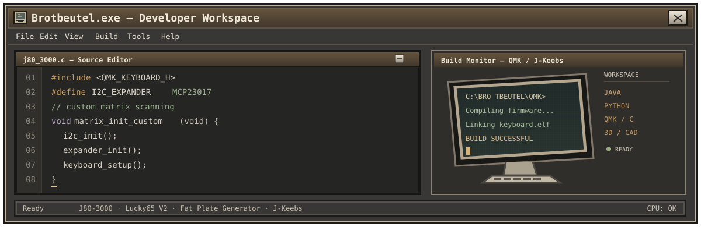

  <table>
    <tr>
      <td bgcolor="#eee9dc" align="center">
        
         
        <b>BROTBEUTEL.EXE — DEVELOPER WORKSPACE</b>
      </td>
    </tr>
  </table>

  <a href="https://brotbeutel.github.io/j-keebs/index.html">J-Keebs</a>
  &nbsp;·&nbsp;
  <a href="https://www.linkedin.com/in/jannik-schl%C3%BCter-103270423/">LinkedIn</a>
  &nbsp;·&nbsp;
  <a href="mailto:jannik_schlueter@hotmail.de">Email</a>

---

## About

I'm Jannik, based near Heidelberg, Germany. My background is in 3D and visual effects, followed by almost a decade in hospitality. These days I'm working towards a career in software development through an **Umschulung as Fachinformatiker für Anwendungsentwicklung** at GFN.

I enjoy projects where software, hardware and design meet. Mechanical keyboards are a pretty good excuse to explore all three.

| **CODE** | **HARDWARE & FIRMWARE** | **DESIGN & MAKING** |
|:--:|:--:|:--:|
| Java · Python · SQL | QMK · microcontrollers | Maya · Blender |
| HTML · CSS · C | I²C · SPI | 3D modelling · printing |

---

## Projects

### Website

**[J-Keebs](https://github.com/Brotbeutel/Brotbeutel.github.io)** · [Visit the website](https://brotbeutel.github.io/j-keebs/index.html)

A website about mechanical keyboards. I use it to document my builds, share mods and collect other keyboard-related projects.

### Keyboard Builds

<table>
  <tr>
    <td width="34%" bgcolor="#eee9dc" align="center">
      
       
      <b>J80-3000 · I²C BUILD</b>
    </td>
    <td valign="top">
      **[J80-3000](https://github.com/Brotbeutel/qmk_firmware)** · [Documentation](https://github.com/Brotbeutel/j80_3000_documentation)

      Two custom builds based on the Cherry G80-3000. Both replace the original controller with a Blackpill microcontroller and use an I/O expander to handle the additional GPIOs.

      - **I²C:** MCP23017 connected via I²C.
      - **SPI:** MCP23S17 connected via SPI.

      The firmware for both builds lives in my [QMK fork](https://github.com/Brotbeutel/qmk_firmware). The documentation repo contains datasheets, pinouts and build notes.
    </td>
  </tr>
</table>

**[Lucky65 V2 – ISO Conversion](https://github.com/Brotbeutel/qmk_firmware)**

Converted the Lucky65 V2 from ANSI to ISO and added QMK support. The firmware is part of my QMK fork.

### Keyboard Tools

**[Fat Plate Generator](https://github.com/Brotbeutel/Fat-Plate-Generator)**

Generates 3D-printable keyboard plates as STL files from KLE raw data.

**[QMK to KLE Converter](https://github.com/Brotbeutel/qmk2kle-converter)**

Converts QMK keyboard layouts (`keyboard.json` / `info.json`) into a format that can be imported into the Keyboard Layout Editor.

### Keyboard Printables

**[Plates'n'Cases](https://github.com/Brotbeutel/Plates-n-Cases)**

A collection of 3D-printable switch plates and keyboard cases designed by me.

---

## Elsewhere

  <a href="https://brotbeutel.github.io/j-keebs/index.html">J-KEEBS / KEYBOARD BUILDS & PROJECTS</a>
  &nbsp;·&nbsp;
  <a href="https://github.com/Brotbeutel?tab=repositories">GITHUB REPOSITORIES</a>

<i>Always happy to talk keyboards, custom builds or weird little maker projects.</i>

